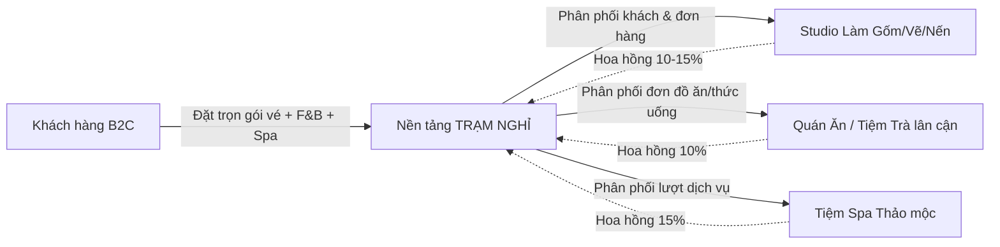

# BÁO CÁO TOÀN DIỆN ĐỀ TÀI ĐỒ ÁN THƯƠNG MẠI ĐIỆN TỬ
# DỰ ÁN: TRẠM NGHỈ — NỀN TẢNG KINH TẾ TRẢI NGHIỆM & KẾT NỐI ĐA DỊCH VỤ TÍCH HỢP AI

---

## MỤC LỤC
1. [GIỚI THIỆU TỔNG QUAN DỰ ÁN](#1-giới-thiệu-tổng-quan-dự-án)
2. [BỐI CẢNH THỊ TRƯỜNG & NỖI ĐAU KHÁCH HÀNG (PAIN POINTS)](#2-bối-cảnh-thị-trường--nỗi-đau-khách-hàng)
3. [MÔ HÌNH KINH DOANH & NGUỒN DOANH THU (B2B2C)](#3-mô-hình-kinh-doanh--nguồn-doanh-thu)
4. [ĐỐI TƯỢNG SỬ DỤNG & ĐẶC TẢ 3 LUỒNG NGHIỆP VỤ CHÍNH](#4-đối-tượng-sử-dụng--đặc-tả-3-luồng-nghiệp-vụ-chính)
   - 4.1. Luồng Khách hàng (Customer Portal)
   - 4.2. Luồng Đối tác cung ứng (Partner Portal)
   - 4.3. Luồng Quản trị viên hệ thống (Super Admin Portal)
5. [HỆ THỐNG CÁC TÍNH NĂNG ĐỘT PHÁ TÍCH HỢP TRÍ TUỆ NHÂN TẠO (AI)](#5-hệ-thống-các-tính-năng-đột-phá-tích-hợp-ai)
   - 5.1. AI Lên lịch trình hẹn hò & thư giãn 1-chạm (AI Day Planner)
   - 5.2. AI Cross-selling: Kết nối Workshop + Ẩm thực F&B + Spa lân cận
   - 5.3. AI Đo cảm xúc & Gợi ý trải nghiệm chữa lành (AI Mood Prescriber)
   - 5.4. AI Viết thiệp & Lời chúc quà tặng cá nhân hóa (AI Gift Wish Generator)
   - 5.5. AI Storyteller: Phân tích ảnh tác phẩm & Tạo thẻ kỷ niệm lan truyền
6. [KIẾN TRÚC KỸ THUẬT & CÔNG NGHỆ ÁP DỤNG (TECH STACK)](#6-kiến-trúc-kỹ-thuật--công-nghệ-áp-dụng)
7. [KẾ HOẠCH TRIỂN KHAI VÀ BẢO VỆ ĐỒ ÁN TRƯỚC HỘI ĐỒNG](#7-kế-hoạch-triển-khai-và-bảo-vệ-đồ-án)

---

## 1. GIỚI THIỆU TỔNG QUAN DỰ ÁN

- **Tên dự án:** Trạm nghỉ (Trạm Nghỉ · A Little Slowness, A Lot of Joy)
- **Định vị thương hiệu:** Nền tảng thương mại điện tử O2O (Online-to-Offline) chuyên về Kinh tế trải nghiệm (Experience Economy), kết nối người trẻ tại các đô thị với các workshop nghệ thuật thủ công (gốm, vẽ tranh, nến thơm), kết hợp chuỗi ẩm thực và dịch vụ thư giãn lân cận.
- **Thông điệp cốt lõi:** *"Bớt một chút vội. Thêm một chút thảnh thơi."*
- **Tông màu nhận diện:** Bảng màu đất ấm, thư giãn:
  - Kem mộc (Paper / Background): `#FAF8F2`
  - Xanh rêu đậm (Deep Ink / Text): `#293D32`
  - Xanh sage (Sage Accent): `#E5ECDC`
  - Cam đào (Warm Peach): `#EEB697`
- **Bộ font chữ:** `Playfair Display` (tiêu đề cổ điển, sang trọng) kết hợp `Be Vietnam Pro` (thân bài hiện đại, rõ nét).

```
        ✳ TRẠM NGHỈ ✳
 Một khoảng thở · Một chút vui
───────────────────────────────
Workshop Thủ công  ✕  F&B Lân cận  ✕  Spa Thảo mộc
       Hỗ trợ bởi AI Lên lịch trình & Thấu cảm
```

---

## 2. BỐI CẢNH THỊ TRƯỜNG & NỖI ĐAU KHÁCH HÀNG

### 2.1. Nỗi đau của Khách hàng cá nhân (End Users):
1. **Quá tải lựa chọn nhưng thiếu định hướng:** Người trẻ đô thị (sinh viên, dân văn phòng) sau cả tuần làm việc thường muốn tìm hoạt động xả stress nhưng bị rơi vào tình trạng *"Không biết cuối tuần đi đâu, làm gì"*.
2. **Chi phí thiếu minh bạch:** Các workshop trên mạng xã hội thường không công khai chi phí phụ thu (tiền tráng men nung gốm, tiền cọ vẽ, nước uống, gói quà), gây tâm lý e ngại.
3. **Bàn lùi khi đi cùng nhóm bạn:** Nhóm 3-5 người gửi hàng chục link fanpage vào nhóm chat nhưng không bao giờ thống nhất được ngày đi hoặc hoạt động chung.
4. **Trải nghiệm đứt gãy:** Đi làm workshop 2 tiếng xong thường phải chật vật tìm quán ăn, quán cà phê gần đó mà không biết chất lượng hoặc hết bàn.

### 2.2. Nỗi đau của Đối tác cung ứng (Studios, Quán ăn, Spa lân cận):
1. **Thiếu kênh bán vé chuyên nghiệp:** Các studio thủ công chủ yếu nhận tin nhắn qua Facebook/Instagram, quản lý thủ công bằng Excel, dễ sót đơn hoặc trùng lịch.
2. **Công suất bàn/chỗ không đồng đều:** Cuối tuần quá tải, ngày trong tuần lại vắng khách, không có công cụ điều phối sức chứa tự động.
3. **Các quán F&B và Spa nhỏ lân cận thiếu khách:** Không có ngân sách chạy quảng cáo đắt đỏ để tiếp cận tệp khách hàng tiềm năng ngay bên cạnh studio.

---

## 3. MÔ HÌNH KINH DOANH & NGUỒN DOANH THU (B2B2C)

Trạm nghỉ hoạt động theo mô hình sàn kết nối 2 đầu:



### Các nguồn thu chính:
1. **Hoa hồng trên mỗi lượt đặt chỗ thành công (Take Rate Commission):**
   - 10% – 15% trên giá trị mỗi vé workshop hoặc combo được thanh toán trên sàn.
2. **Hoa hồng dịch vụ liên kết bán chéo (Cross-selling Commission):**
   - 10% – 15% trên các gói đồ uống, đồ ăn nhẹ, suất ngâm chân/massage tay phát sinh giữa giờ workshop.
3. **Gói dịch vụ quản lý nâng cao cho Đối tác (B2B SaaS Subscription):**
   - Phí dịch vụ phần mềm quản lý lịch hẹn, sơ đồ bàn, tích hợp QR check-in và báo cáo dữ liệu khách hàng.
4. **Phí phát hành Phiếu quà tặng doanh nghiệp (B2B Corporate Gifts):**
   - Cung cấp gói quà tặng phúc lợi nhân viên cho các doanh nghiệp, công ty sáng tạo.

---

## 4. ĐỐI TƯỢNG SỬ DỤNG & ĐẶC TẢ 3 LUỒNG NGHIỆP VỤ CHÍNH

### 4.1. Luồng Khách hàng (Customer Portal)
- **Đăng ký / Đăng nhập:** Xác thực bảo mật qua Supabase Auth (Email/Mật khẩu hoặc Google One-Tap).
- **Bộ lọc thông minh (Catalog Filter):** Lọc theo bộ môn (Gốm, Vẽ, Nến), khu vực (Thảo Điền, Bình Thạnh, Phú Nhuận), lọc theo ngân sách cá nhân.
- **Quiz 4 bước định hướng:** Trắc nghiệm tìm khoảng nghỉ theo tâm trạng, số lượng người, ngân sách và khung giờ.
- **Tự phối Combo (Custom Combo Builder):**
  - Tự chọn workshop chính.
  - Chọn ngày & khung giờ (kiểm tra số chỗ trống còn lại theo thời gian thực).
  - Tự chọn thêm đồ ăn nhẹ (trà trái cây, bánh ngọt giao tận nơi) và gói thư giãn spa.
  - Tổng tiền tự động cập nhật theo đầu người rõ ràng.
- **Bình chọn nhóm (Group Voting):**
  - Khách tạo phòng bình chọn, gửi danh sách 2–4 trải nghiệm.
  - Các thành viên vào bình chọn, hệ thống có thuật toán giải quyết hòa phiếu (tie-breaker) và chuyển thẳng kết quả sang bước đặt chỗ.
- **Tặng khoảng nghỉ (Gift Card):** Chọn mệnh giá, đổi màu thiệp (Sage, Peach, Lavender), gõ lời chúc với sự trợ giúp của AI.
- **Vé của tôi & Quản lý sau mua:**
  - Xem chi tiết vé, mã QR định danh, tải vé dạng file HTML có thể in sang PDF.
  - Đổi lịch (Reschedule) 1 lần miễn phí nếu còn chỗ.
  - Hủy đơn và hoàn chỗ tự động.

---

### 4.2. Luồng Đối tác cung ứng (Partner Portal)
*Dành cho Studio nghệ thuật, quán ăn/tiệm cà phê đối tác và tiệm spa lân cận.*

1. **Đăng ký gian hàng & Quản lý hồ sơ doanh nghiệp:**
   - Đối tác điền thông tin doanh nghiệp: Tên cơ sở, giấy phép kinh doanh/mã số thuế, địa chỉ, ảnh không gian.
   - Chọn loại hình: Studio thủ công, Ẩm thực F&B, hoặc Dịch vụ Thư giãn/Spa.
2. **Đăng tải và Quản lý Dịch vụ (Service Management):**
   - Tạo workshop mới: Tên buổi học, thời lượng, sức chứa tối đa/buổi, giá vé, danh sách vật liệu đã bao gồm, ghi chú cho người mới.
   - Đối tác F&B: Đăng menu combo trà bánh, suất ăn trưa/tối dành riêng cho khách Trạm nghỉ.
   - Đối tác Spa: Đăng gói ngâm chân thảo mộc, massage cổ vai gáy ngắn hạn.
3. **Quản lý Lịch & Khung giờ (Capacity & Slots):**
   - Theo dõi số lượng khách đã đặt cho từng khung giờ (09:00, 14:00, 18:00).
   - Đóng slot khi cần nghỉ đột xuất hoặc mở thêm chỗ khi có thêm người hướng dẫn.
4. **Tiếp nhận & Quét vé (Live Check-in):**
   - Danh sách khách đến trong ngày kèm ghi chú đặc biệt.
   - Nhập mã vé hoặc quét QR để xác nhận khách đã tham gia và kích hoạt giải ngân hoa hồng.
5. **Báo cáo doanh số & Đối soát:**
   - Bảng tổng kết số lượt khách, tổng doanh thu và số tiền nhận về sau khi trừ phí hoa hồng sàn.

---

### 4.3. Luồng Quản trị viên hệ thống (Super Admin Portal)
*Dành cho ban quản trị nền tảng Trạm nghỉ.*

1. **Duyệt và Cấp phép Doanh nghiệp (Business Onboarding):**
   - Xem xét hồ sơ đăng ký của các studio/quán ăn mới, duyệt hoặc từ chối kèm lý do.
   - Quản trị danh mục đối tác đang hoạt động trên hệ thống.
2. **Quản lý Toàn bộ Dịch vụ & Danh mục (Global Catalog Management):**
   - Kiểm soát nội dung các workshop, đảm bảo chất lượng hình ảnh và mô tả đạt chuẩn thương hiệu.
   - Cài đặt danh mục trải nghiệm, phân vùng địa lý.
3. **Quản lý Đơn hàng & Giải quyết tranh chấp:**
   - Tra cứu toàn bộ các giao dịch trên sàn.
   - Hỗ trợ khách đổi lịch khẩn cấp hoặc xử lý khiếu nại hoàn tiền khi studio hủy ca.
4. **Cấu hình Khuyến mãi & Marketing:**
   - Phát hành voucher (như `TRAM10`), quy định mức giảm, ngân sách và hạn sử dụng.
5. **Dashboard Thống kê Chiến lược (Strategic Analytics):**
   - Biểu đồ tăng trưởng doanh thu sàn (GMV), doanh thu hoa hồng (Net Revenue).
   - Chỉ số tỷ lệ lấp đầy (Capacity Utilization Rate) của toàn bộ các studio.
   - Thống kê lượt sử dụng tính năng AI và tỷ lệ chuyển đổi từ gợi ý sang đặt chỗ.

---

## 5. HỆ THỐNG CÁC TÍNH NĂNG ĐỘT PHÁ TÍCH HỢP TRÍ TUỆ NHÂN TẠO (AI)

Đồ án ứng dụng **Google Gemini 1.5 Flash API** để tạo nên sự khác biệt hoàn toàn so với các website thương mại điện tử thông thường:

### 5.1. AI Lên Lịch Trình Hẹn Hò & Thư Giãn 1-Chạm (AI Day Planner)
- **Bài toán:** Khách muốn một buổi hẹn hò trọn vẹn nhưng không biết cách ghép workshop với quán ăn, quán cà phê lân cận sao cho hợp lý về thời gian và địa lý.
- **Hoạt động của AI:** Người dùng nhập: *"Thứ 7 này mình hẹn hò ở Thảo Điền, ngân sách 1 triệu cho 2 người, muốn một buổi chiều thảnh thơi"*. AI Gemini tự động kết hợp:
  - 14:30 – 16:30: Nặn gốm tại Nhà Gốm Nhỏ.
  - 16:45 – 18:00: Trà hoa cúc & bánh tại Tiệm Trà đối diện (giảm 15%).
  - 18:30 – 20:00: Ngâm chân thảo mộc xua tan mỏi mệt.
- Khách bấm **"Đặt trọn gói"**, hệ thống tự động đưa toàn bộ các dịch vụ vào giỏ hàng.

### 5.2. AI Cross-selling: Kết nối Workshop + Ẩm thực + Spa lân cận
- Thuật toán AI phân tích vị trí tọa độ của studio mà khách đang chọn để tự động đề xuất các món ăn/dịch vụ trong bán kính dưới 500m, đảm bảo giao đồ ăn đúng giờ nghỉ giải lao của workshop.

### 5.3. AI Đo Cảm Xúc & Kê Đơn Khoảng Nghỉ (AI Mood Prescriber)
- Khách hàng không cần tìm kiếm mà gõ nhật ký cảm xúc ngắn: *"Hôm nay mình bị stress do deadline, thấy kiệt sức..."*.
- AI dùng cơ chế Phân tích cảm xúc (Sentiment Analysis) để phản hồi ấm áp và "kê đơn" một buổi làm gốm một mình kết hợp trà thảo mộc giúp thư giãn tinh thần.

### 5.4. AI Viết Thiệp & Lời Chúc Quà Tặng Cá Nhân Hóa (AI Gift Wish Generator)
- Khi mua phiếu quà tặng, khách chỉ cần chọn đối tượng (Người yêu, Bạn thân, Mẹ) và mục đích (Sinh nhật, Cổ vũ tinh thần).
- AI tự động sinh ra 3 phương án lời chúc đầy chất thơ, tinh tế, vừa vặn độ dài của tấm thiệp số.

### 5.5. AI Storyteller: Phân tích Ảnh Tác Phẩm & Tạo Thẻ Kỷ Niệm
- Khách chụp ảnh chiếc cốc gốm hoặc bức tranh vừa hoàn thành tải lên web.
- AI Gemini Vision nhận diện màu sắc, phong cách và viết một câu chuyện ngắn mang dấu ấn cá nhân, xuất ra ảnh thẻ số kèm logo Trạm nghỉ để khách chia sẻ lên mạng xã hội (tạo hiệu ứng tiếp thị lan truyền - Viral Loop).

---

## 6. KIẾN TRÚC KỸ THUẬT & CÔNG NGHỆ ÁP DỤNG (TECH STACK)

| Thành phần | Công nghệ lựa chọn | Lý do lựa chọn |
| :--- | :--- | :--- |
| **Frontend Framework** | **Next.js 16 (App Router) + React 19** | Hiệu năng vượt trội, SSR/SSG tối ưu SEO, chuẩn công nghệ công nghiệp hiện đại nhất. |
| **Ngôn ngữ** | **TypeScript** | Định kiểu tĩnh an toàn, giảm thiểu tối đa lỗi lúc vận hành. |
| **Giao diện & Styling** | **Tailwind CSS** | Tùy biến bảng màu đất ấm `#FAF8F2`, `#293D32` nhất quán, giao diện đáp ứng chuẩn Mobile/Desktop. |
| **Cơ sở dữ liệu & Auth** | **Supabase (PostgreSQL)** | Quản lý người dùng, phân quyền RBAC (Customer, Partner, Admin), lưu trữ đơn hàng và quản lý sức chứa theo thời gian thực. |
| **Trí tuệ nhân tạo (AI)** | **Google Gemini 1.5 Flash API** | Tốc độ phản hồi cực nhanh (<1s), chi phí tối ưu, xử lý tốt tiếng Việt tự nhiên và hỗ trợ nhận diện hình ảnh đa phương thức (Multimodal). |
| **Triển khai & CI/CD** | **Vercel Edge Network + GitHub** | Triển khai tự động hóa khi đẩy mã nguồn lên GitHub, hệ thống phân phối nội dung toàn cầu có độ trễ cực thấp. |

---

## 7. KẾ HOẠCH TRIỂN KHAI VÀ BẢO VỆ ĐỒ ÁN TRƯỚC HỘI ĐỒNG

1. **Chuẩn bị Kịch bản Thuyết trình (Demo Script):**
   - **Phút 1-3:** Giới thiệu vấn đề thực tế: Khách hàng trẻ cần khoảng thở xả stress nhưng gặp khó khăn khi chọn chỗ, thống nhất nhóm và tìm dịch vụ ăn uống kèm theo.
   - **Phút 4-8:** Trình diễn Luồng Khách hàng (Quiz chọn nhanh, Trạm AI lên lịch trình hẹn hò 1-chạm, Tự phối combo gốm + trà bánh lân cận, Bình chọn nhóm và nhận vé có mã QR).
   - **Phút 9-12:** Trình diễn Luồng Đối tác & Super Admin (Đăng ký doanh nghiệp mới, duyệt đối tác, đối tác tự đăng workshop/thực đơn F&B, quản lý số chỗ còn lại theo thời gian thực).
   - **Phút 13-15:** Trả lời phản biện về mô hình doanh thu, đạo đức AI và tính khả thi khi nhân rộng ra nhiều thành phố.

---
*Báo cáo được biên soạn độc quyền cho đồ án Thương mại điện tử Trạm nghỉ — Tháng 10/2026.*
